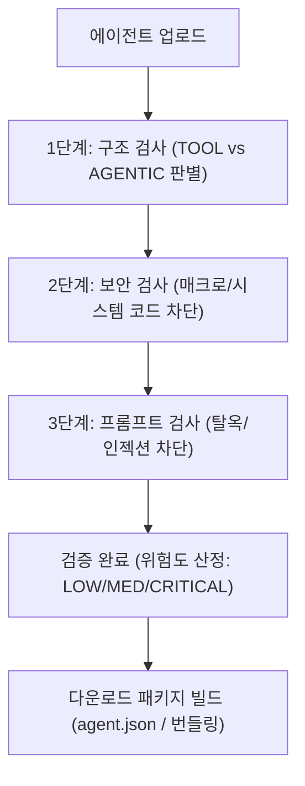

# [AgentMarketPlatform] 에이전트 표준 검증 엔진 & 규격 모듈 (3번 파트)

> **담당**: 3번 파트 (`Jeongkihoon`)  
> **위치**: `agent-validator/`  
> **역할**: 에이전트 유형 규격화, 업로드 3단계 검증 엔진, 다운로드 패키징 및 의존성 번들링

---

## 📌 3번 파트 핵심 역할 및 설계 배경

마켓플레이스 플랫폼에서 웹 브라우저가 직접 무겁게 에이전트를 실행하는 대신, **"검증된 안전한 에이전트를 유통하고, 사용자가 다운로드하여 본인의 LLM(MCP/API Key)에 바로 붙여 쓸 수 있게 한다"**는 아키텍처에 맞춰 설계된 핵심 검증 모듈입니다.

특히 **AI 에이전트(피클) 코레일·항공사 차단 사태**의 원인이었던 비인가 매크로/스크래핑을 원천 차단하고, 프롬프트 인젝션 및 중요 작업(결제/예약)에 대한 Human-in-the-Loop 승인을 보장합니다.

---

## 🛠️ 주요 제공 기능



### 1. 에이전트 유형 이원화
* **도구형 (`TOOL`)**: LLM이 Function Calling으로 호출하는 단일 함수. `inputSchema`, `outputSchema`, `run(task)` 진입점 필수.
* **에이전틱 AI (`AGENTIC`)**: 목표와 프롬프트를 가진 자율형 비서. `prompt`, `requiredTools`, `modelRecommendation` 명세.

### 2. 3단계 검증 파이프라인
* **1단계 구조 검사 (Structure)**: 필수 메타데이터, 스키마 유효성, 타입별 필수 요소 확인
* **2단계 코드 보안 (Security - 피클 사태 방어)**:
  * 시스템 파괴 위험 함수(`os.system`, `subprocess`, `eval`) 차단
  * **비인가 매크로/스크래핑 라이브러리(`selenium`, `playwright`, `pyautogui` 등) 마켓 등록 차단**
* **3단계 프롬프트 보안 (Prompt Security)**: 시스템 프롬프트 탈옥, 지시 무시, 기밀 유출 유도 문구 검출

### 3. 위험도 3단계 자동 분류 (Tiered Risk Assessment)
* `LOW` (단순 연산, 텍스트 요약): 자동 실행 허용
* `MEDIUM` (파일 저장, 데이터 변환): 알림 배너
* `CRITICAL` (결제, 예약, 개인정보, 계정 연동): **Human-in-the-Loop(사용자 승인) 필수 강제**

### 4. 의존성 번들러 (Dependency Bundler)
* 에이전틱 에이전트가 요구하는 하위 도구형 에이전트들을 마켓에서 한 번에 묶음(Bundle)으로 패키징하여 다운로드 지원.

---

## 💻 CLI 실행 및 테스트

```powershell
# 1. 종합 단위 테스트 실행 (6개 주요 시나리오)
node agent-validator/test.js

# 2. 로컬 에이전트 패키지 즉시 검증 (CLI)
node agent-validator/cli.js agents/text_analyzer
node agent-validator/cli.js agents/demo_agent
```

---

## 🤝 다른 파트 조원 연동 방법

### 1번 조원 (웹 프론트엔드)
사용자가 마켓에 에이전트를 업로드할 때 브라우저에서 즉시 유효성을 검사할 수 있습니다:
```javascript
import { AgentValidator } from "../agent-validator/validator.js";

const result = AgentValidator.inspect(manifest, code);
if (!result.success) {
    alert(`업로드 반려: ${result.summary}`);
}
```

### 2번 조원 (Spring Boot 백엔드)
* 업로드 API(`POST /api/agents`)에서 검증 실패 시 반환할 표준 에러 응답 및 에이전트 메타데이터 규격을 `AgentValidator`의 스키마와 1:1로 매핑하여 사용합니다.

### 4번 조원 (로컬 FastMCP 서버)
* 다운로드된 `agent.json`의 `toolBinding` 규격을 그대로 읽어 FastMCP 서버에 도구로 자동 등록합니다.
