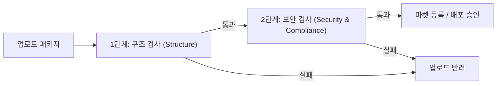

# [AgentMarketPlatform] 3번 파트: 에이전트 규격·검증 및 런타임 연동 가이드

> **작성자**: 3번 파트 담당자 (`Jeongkihoon`)  
> **대상**: 1번(웹 마켓플레이스 프론트엔드), 2번(백엔드 및 에이전트 관리), 4번(로컬 MCP 서버) 조원  
> **위치**: `my-agent-runtime/`, `browser-runtime/`  
> **최신 개정일**: 2026-11-22 (에이전트 정의 분리 및 피클 사태 보안 정책 반영)

---

## 📌 3번 파트 핵심 책임 및 업데이트 요약

최근 AI 에이전트 차단 사태(코레일/항공사의 제3자 에이전트 차단) 및 팀 회의 결정에 따라 3번 파트의 역할이 다음과 같이 고도화되었습니다:

1. **에이전트 정의 분리**: 도구형 에이전트(`TOOL`)와 자율형 에이전틱 에이전트(`AGENTIC`)의 표준 입출력 및 메타데이터 규격화
2. **2단계 업로드 검증 엔진**:
   - `1단계 (구조 검사)`: 필수 파일, 스키마, 에이전트 유형 판별
   - `2단계 (보안 검사)`: 악성 시스템 호출 차단 + **피클 사태 방지용 매크로/스크래핑 라이브러리(`selenium`, `playwright` 등) 차단**
3. **다운로드 및 LLM 연동 규격**: 마켓에서 다운로드하여 사용자의 LLM(FastMCP 도구 또는 API Key 주입)에 바로 꽂아 쓸 수 있는 실행 패키지 포맷
4. **Human-in-the-Loop (인간 승인) 게이트**: 결제, 예약 등 민감한 동작 시 사용자의 명시적 승인을 거치도록 강제하는 파이프라인 인터페이스

---

## 📦 1. 에이전트 유형별 표준 패키지 규격 (2번 백엔드 & 공통)

에이전트는 `manifest.json`의 `type` 필드에 따라 2가지로 명확히 구분됩니다.

### ① 도구형 에이전트 (`TOOL`)
LLM이 필요할 때 Function Calling으로 호출하는 단일 기능형 에이전트입니다.
```json
{
  "id": "calculator",
  "name": "수학 계산기 도구",
  "type": "TOOL",
  "version": "1.0.0",
  "description": "사칙연산 및 수학 표현식을 계산합니다.",
  "entrypoint": "agent.py",
  "inputSchema": {
    "type": "string",
    "description": "계산할 수학 수식 문자열"
  },
  "outputSchema": {
    "type": "string",
    "description": "계산 결과"
  },
  "requiresConfirmation": false
}
```

### ② 에이전틱 AI 에이전트 (`AGENTIC`)
자체 목표, 시스템 프롬프트(페르소나), 추론 루프를 가진 자율형 에이전트입니다.
```json
{
  "id": "policy_risk_analyzer",
  "name": "정책 리스크 분석관",
  "type": "AGENTIC",
  "version": "1.0.0",
  "description": "자율적으로 플랫폼 이용약관 및 규제 리스크를 심층 분석합니다.",
  "prompt": "당신은 플랫폼 정책 분석 전문 AI입니다. 입력된 기사와 약관에서 충돌 요소를 자율적으로 분석하세요.",
  "requiredTools": ["calculator", "text_analyzer"],
  "requiresConfirmation": true,
  "permissions": ["network:api"]
}
```

---

## 🛡️ 2. 업로드 2단계 검증 엔진 (2번 백엔드 & 1번 프론트)

마켓플레이스에 에이전트를 등록하거나 클라이언트에서 로드할 때 3번의 `AgentValidator`를 통해 검증을 수행합니다.



### 1단계: 구조 검사 (Structure Validation)
* 필수 메타데이터(`id`, `name`, `version`, `description`) 확인
* ID 명명 규칙(`^[A-Za-z0-9_-]+$`) 준수 여부
* 도구형(`TOOL`): `entrypoint` 존재 여부, `inputSchema`/`outputSchema` 유효성, `run(task)` 함수 구현 검사
* 에이전틱형(`AGENTIC`): `prompt` 문자열 존재 여부, `requiredTools` 배열 유효성 검사

### 2단계: 보안 검사 (Security Inspection - 기사 이슈 완벽 반영)
* **시스템 악성 코드 차단 (Critical Block)**:
  `eval()`, `exec()`, `compile()`, `os.system()`, `subprocess.*`, `pty.spawn()` 등 시스템 쉘 직접 조작 차단
* **비인가 매크로/스크래핑 라이브러리 차단 (Macro Block)**:
  * 차단 대상: `selenium`, `playwright`, `pyppeteer`, `pyautogui`, `pynput`, `keyboard`, `mouse`
  * *사유: 코레일/항공사처럼 제3자 에이전트가 백그라운드 웹 자동화로 대리 예매를 시도하는 것은 보안 솔루션 탐지 및 서비스 차단 대상이 되므로 마켓 등록을 원천 차단함*
* **안전 권고(Warning)**:
  * 결제/예약/주문 등 민감 키워드가 포함되었는데 `requiresConfirmation: true`가 선언되지 않은 경우 사용자 승인 게이트 지정 권고

### 검증 모듈 사용법 (JavaScript)
```javascript
import { AgentValidator } from "./src/loader/agentValidator.js";

const inspection = AgentValidator.inspect(manifest, code);
if (!inspection.success) {
    console.error(`업로드 실패 (${inspection.stage}):`, inspection.summary);
} else {
    console.log(`검증 통과 [유형: ${inspection.structure.type}]`);
}
```

---

## 🤝 3. 1번 조원 (웹 프론트엔드) 연동 가이드

### ① Human-in-the-Loop (HITL) 승인 모달 연동
에이전트가 단독으로 결제나 예약을 실행하지 못하도록, `requireApproval: true`인 단계는 사용자의 확인을 거칩니다.

```javascript
import { WorkflowEngine } from "./src/workflow/workflowEngine.js";

const workflow = new WorkflowEngine(agentLoader, llmEngine);

// 승인이 필요한 단계가 오면 자동으로 호출되는 콜백
workflow.onApprovalRequired = ({ stepIndex, step, output, resolve, reject }) => {
    // 1번 조원의 승인 팝업/모달 UI 띄우기
    openApprovalModal({
        title: `${step.label} 검토 요청`,
        content: output,
        onApprove: (editedData) => resolve(editedData || output), // 수정본 또는 원본 승인
        onReject: () => reject("사용자 거절")                      // 파이프라인 중단
    });
};
```

---

## 🔌 4. 4번 조원 (로컬 FastMCP 서버 및 커넥터)과의 호환성

3번에서 정의한 `AgentValidator.buildDownloadPackage(manifest, code)`를 통해 생성된 `agent.json` 패키지는 4번의 FastMCP 서버와 100% 호환됩니다:
* `TOOL` 에이전트: 4번의 `server.py`가 동적 Tool로 등록 (`@mcp.tool()`)
* `AGENTIC` 에이전트: 시스템 프롬프트 및 도구 툴체인이 포함되어 Claude Desktop 또는 로컬 LLM에 에이전트 페르소나로 즉시 주입 가능

---

## 💻 테스트 및 확인
```powershell
# 브라우저 실행 런타임 테스트
cd my-agent-runtime
npm.cmd run dev
```
문의사항이나 스키마 확장이 필요하시면 언제든 3번 담당자에게 알려주세요!
